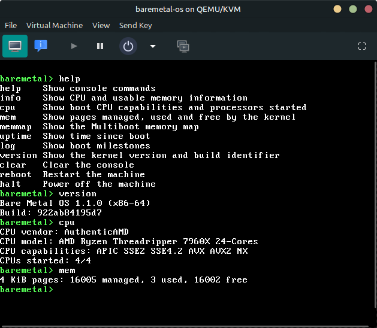

# Bare Metal OS

[](https://github.com/melroy89/baremetal-os/actions/workflows/boot-smoke.yml)

A small standalone operating system written in x86-64 assembly (NASM). At startup, a Multiboot 1 bootloader hands control to the kernel in 32-bit mode. The kernel switches the CPU to 64-bit mode and opens a text console you can use with a screen and keyboard or through a serial terminal.

## Download

Download the latest release from [GitHub Releases](https://github.com/melroy89/baremetal-os/releases).

- `baremetal-os.elf` boots directly as a kernel in QEMU/KVM.
- `baremetal-os.iso` boots as a CD/DVD image with BIOS or UEFI firmware.
- `SHA256SUMS` lets you verify the downloads.



## Quick start

Run these commands from the directory containing the downloaded file.

### Run directly with QEMU/KVM

This option runs entirely in your terminal and needs QEMU and access to `/dev/kvm`.

```sh
sudo apt install qemu-system-x86
qemu-system-x86_64 -enable-kvm -cpu host -m 64M -smp 1 -nic none \
  -kernel baremetal-os.elf -display none -serial stdio -monitor none
```

This starts one vCPU with 64 MiB of RAM. Use `-smp 4` for four virtual CPUs.

### Boot the ISO

Attach `baremetal-os.iso` as a CD/DVD image and boot from it.

- **SeaBIOS** is the choice for a graphical first boot. With 64 MiB of RAM, the prompt appears on both VGA and serial.
- **UEFI (OVMF)** requires the serial console. Select x86-64 UEFI firmware with Secure Boot disabled, allocate 128 MiB of RAM, and open the VM's serial console. OVMF can report `no suitable video mode found` on the graphical display while the kernel runs on serial.

This QEMU command boots the ISO with SeaBIOS and opens the serial console in your terminal.

```sh
qemu-system-x86_64 -m 64M -nic none -cdrom baremetal-os.iso \
  -display none -serial stdio -monitor none
```

For UEFI, install `ovmf`, replace `-m 64M` with `-m 128M`, and add `-bios /usr/share/ovmf/OVMF.fd`. The firmware path may vary by distribution.

## Console quick reference

At the `baremetal>` prompt, start with `help`.

| Command                    | Action                                             |
| -------------------------- | -------------------------------------------------- |
| `help`                     | List console commands.                             |
| `info`, `cpu`, `mem`       | Inspect the guest, CPU, and memory.                |
| `lspci`                    | List PCI devices.                                  |
| `disk info`                | Inspect the attached IDE disk.                     |
| `net info`                 | Show the Ethernet adapter and link state.          |
| `ls`                       | List RAM files.                                    |
| `uptime`, `log`, `version` | Check runtime, boot milestones, and build details. |
| `reboot`, `halt`           | Restart or power off the guest.                    |

## Documentation

- [Console commands and RAM files](docs/console.md)
- [IDE storage, GPT, and FAT32](docs/storage.md)
- [Ethernet setup and frame commands](docs/networking.md)
- [Run with libvirt or Proxmox VE](docs/virtualization.md)

---

## Build from source

On Debian, Ubuntu, or Linux Mint, install the build tools, then run `make` from the project checkout.

```sh
sudo apt install nasm binutils make coreutils
make
```

The kernel is `build/baremetal-os.elf`. With QEMU/KVM set up, use `make os-run` to build and boot it directly, or `make os-run SMP=4` for four vCPUs.

### Build a BIOS and UEFI bootable ISO

Install both GRUB platform packages for a hybrid image. GRUB uses the platform modules available when it builds the ISO.

```sh
sudo apt install grub-common grub-pc-bin grub-efi-amd64-bin mtools xorriso
make os-iso
```

The image is `build/baremetal-os.iso`. If you added a GRUB platform after building it, run `make -B os-iso` to rebuild it. To use the ELF or ISO with the run instructions above, run them from the `build/` directory.

Run `make test-ata test-gpt test-fat32 test-network` for the device tests. They use QEMU, `qemu-img`, `sgdisk`, `dosfstools`, `mtools`, and `socat`.

### Kernel overview

The kernel sets up paging and CPU exception handlers and starts additional CPUs through the local APIC. When the CPU list is known and enough pages are available, the allocator supplies one 4 KiB stack page per secondary CPU, counted in `mem`. Other boot paths use stack space reserved by the loader. The boot CPU runs the console and sleeps between keyboard and serial interrupts. Storage and Ethernet use polled I/O when requested by a console command.

## Credits

Bootstrap and drivers adapted from Alexey Fateev's [llm.asm (MIT)](https://github.com/alesha-pro/llm.asm).
